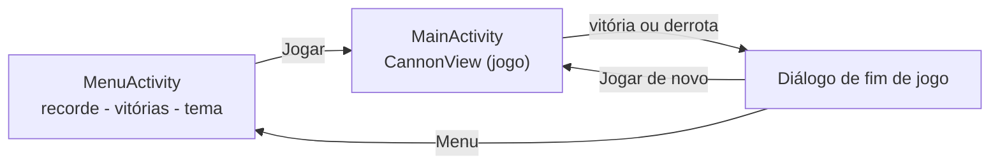
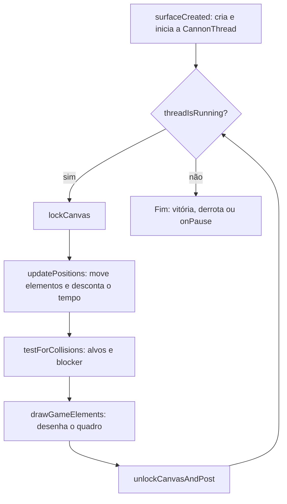
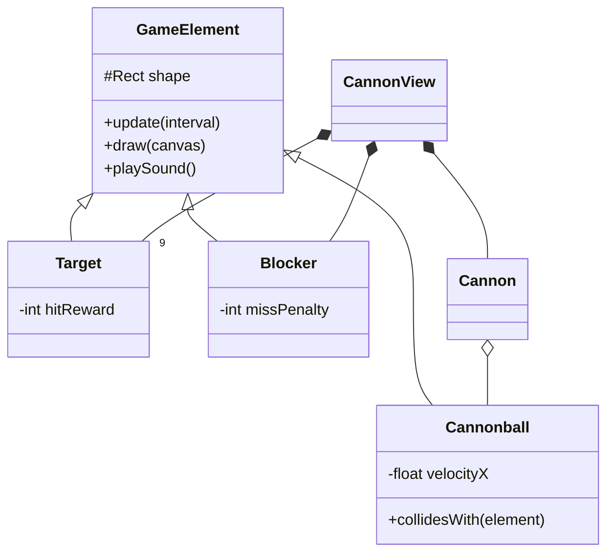
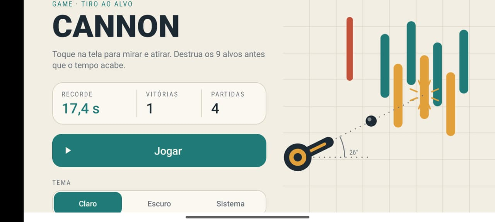
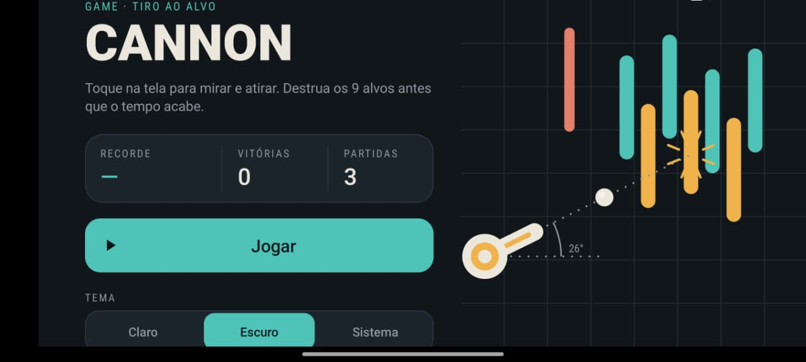
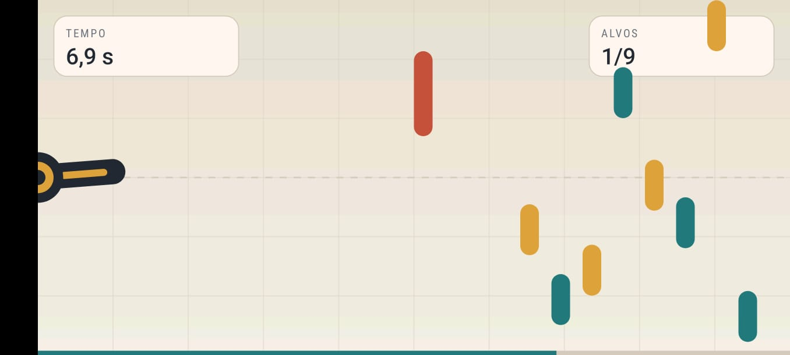

[README.md](https://github.com/user-attachments/files/33464606/README.md)
<div align="center">

# 💣 Cannon Game

**Jogo de tiro ao alvo para Android, feito com `SurfaceView`, `Canvas` e game loop em thread própria.**

Trabalho colaborativo da disciplina de **Programação III** · UEMG – Passos


-1F7A78?style=for-the-badge)


</div>

---

## 📑 Sumário

- [👥 Integrantes](#-integrantes)
- [🎯 Objetivo do projeto](#-objetivo-do-projeto)
- [🎮 Como o jogo funciona](#-como-o-jogo-funciona)
- [▶️ Como executar a aplicação](#️-como-executar-a-aplicação)
- [✨ Funcionalidades implementadas](#-funcionalidades-implementadas)
- [🧠 Conceitos da disciplina aplicados](#-conceitos-da-disciplina-aplicados)
- [🏗️ Arquitetura e estrutura do projeto](#️-arquitetura-e-estrutura-do-projeto)
- [📸 Screenshots](#-screenshots)
- [📚 Referência](#-referência)

---

## 👥 Integrantes

| Nome | GitHub |
| --- | --- |
| **João Pedro de Almeida Modesto** | [@Modesto505](https://github.com/Modesto505) |
| **Gustavo Vieira Barbosa** | [@Gustavo777654](https://github.com/Gustavo777654) |

---

## 🎯 Objetivo do projeto

Aplicar, em um jogo completo, os conceitos estudados em **Programação III** por meio do desenvolvimento colaborativo da aplicação **Cannon Game**, apresentada no **Capítulo 6** do livro *Android 6 for Programmers: An App-Driven Approach* (3ª edição).

O projeto cobre tópicos essenciais do desenvolvimento mobile profissional:

- 🎞️ animação quadro a quadro (*manual frame-by-frame animation*);
- 🎨 manipulação gráfica com `Canvas` e `Paint`;
- 🔊 execução de sons;
- 🧵 controle de threads para a lógica do jogo e o *game loop*;
- 🖼️ uso de `SurfaceView` e `SurfaceHolder`;
- 📱 modo imersivo e tela cheia;
- 👆 interatividade por toque com atualização responsiva da interface.

---

## 🎮 Como o jogo funciona

Destrua os **9 alvos** antes que os **10 segundos** acabem. Toque (ou arraste o dedo) na tela para mirar: o canhão aponta para o ponto tocado e dispara.

| Evento | Efeito |
| --- | --- |
| 🎯 Acertar um alvo | **+3 s** no relógio e o alvo some |
| 🧱 Acertar o *blocker* | **−2 s** e a bala volta |
| 🔫 Tiros | Só **uma bala por vez** na tela |
| ⏱️ Tempo chega a zero | **Derrota** |
| ✅ Todos os alvos destruídos | **Vitória** |

Ao final, um diálogo mostra o resultado, os **tiros disparados** e o **tempo total**, com os botões **Jogar de novo** e **Menu**.



---

## ▶️ Como executar a aplicação

### Requisitos

| Item | Versão |
| --- | --- |
| Android Studio | **Ladybug (2024.2.1)** ou mais recente |
| JDK | **17** (já vem embutido no Android Studio) |
| Android SDK | API **34** instalada (`compileSdk 34`) |
| Dispositivo | Emulador ou celular com **Android 7.0 (API 24)** ou superior |

### Passo a passo (Android Studio)

1. **Clone o repositório**
   ```bash
   git clone <https://github.com/Modesto505/CannomGameAndroid.git>
   ```
2. No Android Studio, vá em **File ▸ Open** e selecione a pasta `CannonGame`.
3. Aguarde o **Gradle Sync** terminar (a primeira vez baixa as dependências e exige internet).
4. Escolha um **emulador** (Device Manager) ou conecte um **celular com depuração USB**.
5. Clique em **Run ▶** (ou `Shift + F10`).

### Alternativa: pelo terminal

Com um dispositivo/emulador conectado:

```bash
# Linux / macOS
./gradlew installDebug

# Windows
gradlew.bat installDebug
```

Para apenas gerar o APK (fica em `app/build/outputs/apk/debug/app-debug.apk`):

```bash
./gradlew assembleDebug
```

> [!NOTE]
> O jogo roda somente em **paisagem (*landscape*)**, conforme a seção 6.4.1 do livro. Em emuladores lentos a bala pode parecer atravessar os alvos: é um efeito esperado quando poucos quadros são desenhados por segundo (o livro comenta isso na seção 6.1).

---

## ✨ Funcionalidades implementadas

### Núcleo do jogo (Capítulo 6)

- [x] Canhão que **mira e dispara** na direção do ponto tocado
- [x] **9 alvos** com velocidades aleatórias e cores alternadas
- [x] **Blocker** móvel que rebate a bala
- [x] **Contagem regressiva** com bônus (+3 s) e penalidade (−2 s)
- [x] **Detecção de colisão** por retângulos (`Rect.intersects`)
- [x] **Três efeitos sonoros**: disparo, alvo atingido e blocker atingido
- [x] **Game loop em thread separada**, com movimento baseado no tempo decorrido (o jogo roda na mesma velocidade em aparelhos diferentes)
- [x] **Modo imersivo** / tela cheia
- [x] **Diálogo de fim de jogo** com opção de reiniciar

### Extras além do livro

- [x] **Tela de menu** com recorde, vitórias, partidas e botão **Jogar**
- [x] **Recorde local** (menor tempo para vencer), salvo com `SharedPreferences` (`GameStats`)
- [x] **Tema claro / escuro / do sistema**, escolhido no menu e lembrado entre execuções (`AppSettings` + `values-night`)
- [x] **Tela de fim de jogo aprimorada**: tiros, tempo, selo de **novo recorde** e botões *Jogar de novo* / *Menu*
- [x] **Visual redesenhado**: painel de tempo e alvos (HUD), barra de tempo, alvos arredondados e cores que acompanham o tema
- [x] **Ilustração do menu desenhada em código** com `Canvas` (`MenuArtView`), sem usar imagens

---

## 🧠 Conceitos da disciplina aplicados

Onde cada tópico pedido no trabalho aparece no código:

| Conceito | Onde está | Como foi aplicado |
| --- | --- | --- |
| **Animação quadro a quadro** | `CannonView.CannonThread.run()` | A cada iteração do loop o jogo calcula o tempo desde o quadro anterior, atualiza as posições e redesenha tudo |
| **Canvas e Paint** | `CannonView.drawGameElements()`, `GameElement`, `Cannon`, `Cannonball` | Fundo em degradê, grade, HUD, canhão, alvos e bala são desenhados manualmente com `Canvas` e `Paint` |
| **Execução de sons** | `CannonView` (`SoundPool`, `AudioAttributes`) | Três `.wav` em `res/raw/`; `setVolumeControlStream` permite controlar o volume pelos botões do aparelho; recursos liberados em `releaseResources()` |
| **Threads e game loop** | `CannonView.CannonThread` | Thread dedicada ao jogo, flag `volatile` para pará-la, `synchronized` no `SurfaceHolder`, `join()` ao destruir a superfície e `runOnUiThread` para abrir o diálogo |
| **SurfaceView e SurfaceHolder** | `CannonView` | Implementa `SurfaceHolder.Callback` (`surfaceCreated` / `surfaceChanged` / `surfaceDestroyed`) e usa `lockCanvas` / `unlockCanvasAndPost` |
| **Modo imersivo** | `CannonView.hideSystemBars()` | Esconde barra de status e de navegação com as flags `SYSTEM_UI_FLAG_*` ao iniciar cada partida |
| **Interatividade por toque** | `CannonView.onTouchEvent()` | `ACTION_DOWN` e `ACTION_MOVE` calculam o ângulo com `Math.atan2` e disparam o canhão |
| **Interface responsiva** | `CannonView.onSizeChanged()` | Tamanhos e velocidades definidos como **porcentagem** da tela, então o jogo se adapta a qualquer resolução |

### Ciclo do game loop



---

## 🏗️ Arquitetura e estrutura do projeto

```text
CannonGame/
├── app/src/main/
│   ├── java/com/deitel/cannongame/
│   │   ├── CannonApp.java             # aplica o tema salvo ao iniciar o app
│   │   ├── MenuActivity.java          # tela inicial (recorde, Jogar, tema)
│   │   ├── MenuArtView.java           # ilustração do menu desenhada com Canvas
│   │   ├── AppSettings.java           # tema claro / escuro / sistema
│   │   ├── GameStats.java             # recorde, vitórias e partidas
│   │   ├── MainActivity.java          # hospeda o fragment do jogo
│   │   ├── MainActivityFragment.java  # cria a CannonView; ciclo de vida e volume
│   │   ├── CannonView.java            # lógica do jogo, game loop, toque e sons
│   │   ├── GameElement.java           # superclasse de Blocker, Target e Cannonball
│   │   ├── Blocker.java               # obstáculo que rebate a bala (penalidade)
│   │   ├── Target.java                # alvo (recompensa de tempo)
│   │   ├── Cannon.java                # canhão: mira e disparo
│   │   └── Cannonball.java            # a bala
│   ├── res/
│   │   ├── layout/    # activity_menu, activity_main, fragment_main, dialog_game_result
│   │   ├── raw/       # cannon_fire.wav, target_hit.wav, blocker_hit.wav
│   │   ├── drawable/  # fundos de botões, cartões e ícones
│   │   ├── values/        # strings, colors (modo claro), styles
│   │   └── values-night/  # colors do modo escuro
│   └── AndroidManifest.xml
├── docs/                              # GIF e screenshots usados neste README
├── build.gradle · settings.gradle · gradle.properties
└── gradlew · gradlew.bat
```

### Hierarquia das classes do jogo



### Tecnologias

- **Java 17** · **Android Gradle Plugin 8.7.3** · **Gradle 8.9**
- `compileSdk 34` · `targetSdk 34` · `minSdk 24`
- **AndroidX AppCompat 1.7.0** (`AppCompatActivity`, `Fragment`, `DialogFragment`, `AppCompatDelegate` para o tema)
- APIs do Android: `SurfaceView`, `Canvas`, `Paint`, `SoundPool`, `SharedPreferences`

---

## 📸 Screenshots

<!--
  COMO ADICIONAR:
  1. Crie a pasta docs/screenshots/ na raiz do projeto.
  2. Salve as imagens com os nomes abaixo (ou troque os nomes aqui).
  3. Dica: no Android Studio, use o botão de câmera do Running Devices / Emulator para capturar.
-->

### 🖼️ Telas

<div align="center">
  
| Modo claro | Modo escuro |
| :---: | :---: |
|  |  |

| Jogo em Execução |
| :---: |
|  |

</div>

---

## 📚 Referência

DEITEL, P.; DEITEL, H.; DEITEL, A. **Android 6 for Programmers: An App-Driven Approach**. 3ª ed. Pearson, 2016. Capítulo 6 – *Cannon Game App*.

---

<div align="center">

Feito com ☕ por **João Pedro de Almeida Modesto** e **Gustavo Vieira Barbosa** · Programação III · UEMG – Passos

</div>
